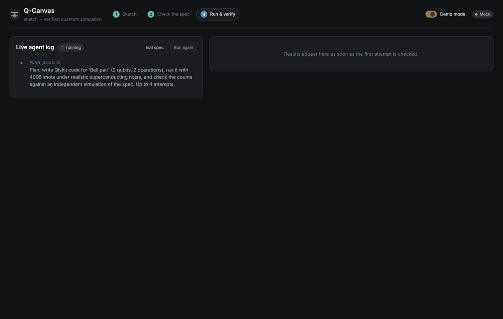
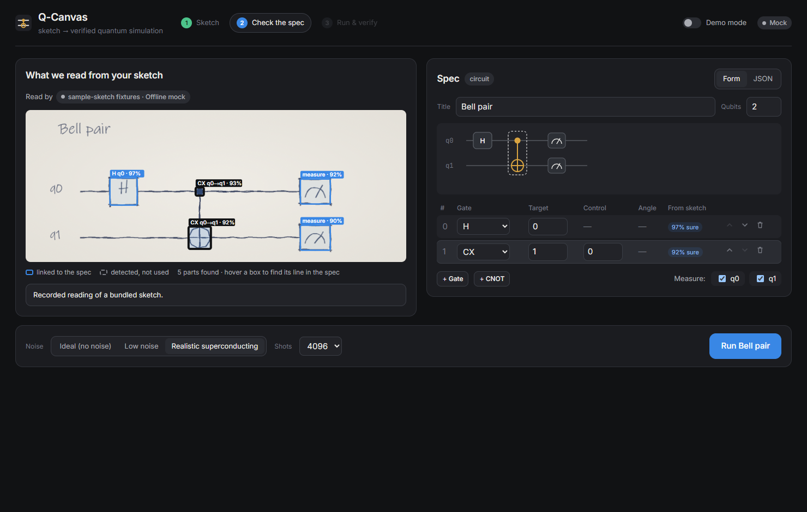
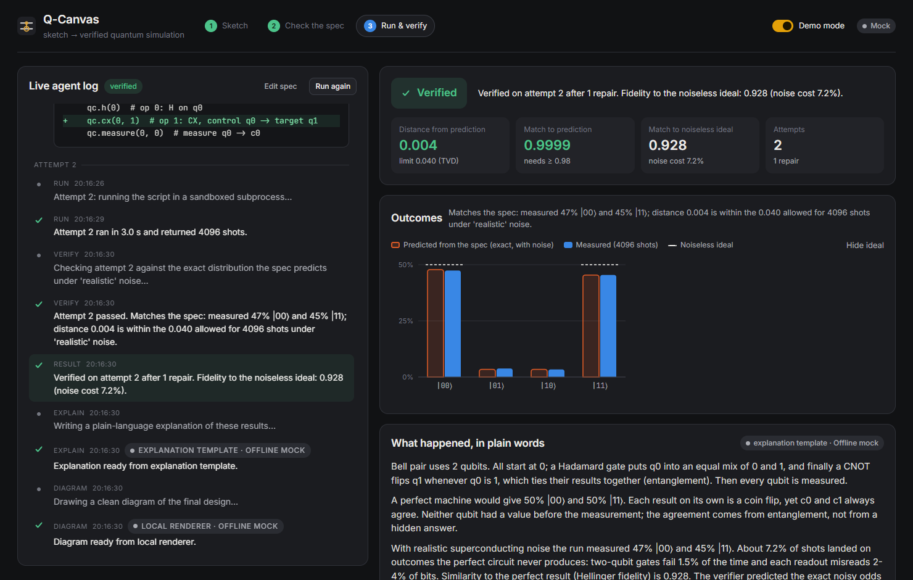
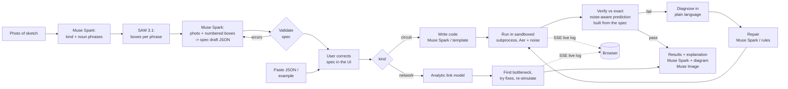

# Q-Canvas

**Draw a quantum circuit or a satellite link on paper. Get running, verified code in seconds.**

Q-Canvas turns a photo of a hand-drawn quantum circuit or quantum network into a
structured spec, writes Qiskit code for it, runs that code under realistic noise,
and **proves the result is right** by checking it against an independent
simulation of the spec. When the code is wrong, a self-repair agent diagnoses the
failure in plain language, fixes it, and runs it again, live on screen.

Built for the **Meta Global AI Developer Hackathon 2026**, theme **Push the
Frontier** ("accelerate a scientific experiment").



## Why it matters

Quantum programs fail silently. A reversed CNOT or a qubit index off by one still
runs and still prints a histogram; it is just the wrong histogram. Students and
researchers sketch circuits and network layouts on paper long before they write
code, and the jump from sketch to *correct* code is where time goes.

Q-Canvas closes that gap and refuses to fake success:

- Every run is compared with the **exact** distribution the spec predicts under
  the same noise model, computed by a separate code path that never sees the
  generated code.
- Failures are reported honestly. If the agent cannot fix the code, the result
  is marked **Not verified**, and the code and counts are labelled as unverified.
- Every model answer says which model produced it, and an offline mock is always
  labelled as a mock.

## What it does

| Step | What happens | Model |
| --- | --- | --- |
| 1. Sketch | Upload a photo (or pick a sample, or paste JSON) | |
| 2. See the parts | The kind of diagram is identified and every drawn part is boxed | **Muse Spark 1.3** picks noun phrases, **SAM 3.1** segments each one |
| 3. Read it | The boxes and the photo become a validated JSON spec, each operation linked to its box | **Muse Spark 1.3** with structured output |
| 4. Correct it | Side-by-side photo overlay and editor (form or raw JSON); hover a box to find its line; live validation with readable errors | |
| 5. Run and verify | The agent writes the code, runs it in a sandboxed subprocess, verifies, diagnoses, repairs, retries (up to 4 attempts) | **Muse Spark 1.3** writes and repairs code (or the **Muse Code** CLI, opt-in) |
| 6. Understand it | Histogram (predicted vs measured vs ideal), metrics, code with per-attempt diffs, plain-language explanation, clean diagram | **Muse Spark 1.3** explains, **Muse Image 1.0** draws |
| Network mode | Physics model of every link, bottleneck search, fixes re-simulated, before/after | **Muse Spark 1.3** explains, **Muse Image 1.0** draws |

<table>
<tr>
<td></td>
<td></td>
</tr>
</table>

## Architecture



Backend: Python 3.11+, FastAPI, Qiskit 2.6 + qiskit-aer 0.18, pydantic v2, SSE.
Frontend: React 19 + TypeScript + Vite. No database; jobs live in memory.

```
backend/qcanvas/
  spec/      versioned pydantic models, readable validation, schema.json, model-facing draft schema
  adapters/  model interfaces; meta (Meta Model API) and mock implementations, cache, fallback
  codegen/   deterministic template codegen, static safety check
  sim/       noise presets, sandboxed subprocess runner
  verify/    independent expected distributions, metrics, verdicts
  agent/     the loop, fault injection, diagnosis, rule-based repairer, event bus
  network/   physics, link model, fix search, network agent, explanation
  explain/   explanation templates, diagram rendering
  api/       FastAPI app and job store
frontend/src/  React app (start, overlay + editor, live log, results)
examples/      specs and sample sketches (with ground-truth fixtures)
```

## How each Meta model is used

All calls go to `https://api.meta.ai/v1` with `Authorization: Bearer $META_API_KEY`,
using only endpoints and fields documented in Meta's docs (list of pages in
[`docs/meta-api/SOURCES.md`](docs/meta-api/SOURCES.md)).

- **SAM 3.1** (`sam-3.1`, `POST /v1/responses`, streamed): one concept prompt per
  noun phrase with the photo as a data URL and `metadata.include_confidence: "true"`.
  The special-token output (`<0f>0<|box;x1=..;c=..|><|mask;...|>`) is parsed into
  boxes and confidences, scaled to the uploaded image.
- **Muse Spark 1.3** (`muse-spark-1.3`, `POST /v1/chat/completions`):
  1. looks at the photo and names what SAM should look for (`response_format`
     JSON schema, `reasoning_effort: low`), the pairing Meta's docs recommend;
  2. reads the photo plus a copy with numbered boxes (set-of-marks prompting)
     into a spec draft with structured output, linking every operation to a SAM
     box; invalid drafts are re-prompted once with the readable validation errors;
  3. writes the Qiskit script and, when verification fails, repairs it, given the
     spec, the code, the error, the verifier's verdict, the diagnosis and the
     history of earlier attempts;
  4. explains the final result to a student using the real numbers.
- **Muse Image 1.0** (`muse-image-1.0`, `POST /v1/images/generations`,
  `response_format: b64_json`): a clean, annotated illustration of the final
  design. It is always shown next to the exact Qiskit drawing, so an imperfect
  illustration can never mislead.
- **Muse Code** (opt-in, `QCANVAS_CODE_BACKEND=muse-cli`): repairs are handed to
  the Muse Code agent headlessly (`muse exec --prompt-file task.txt
  --disable-approval --max-model-steps 12`) in a scratch workspace; Q-Canvas's
  verifier, not the CLI's exit code, decides whether the fix worked.

Responses are cached on disk by request hash (`backend/.qcanvas_cache/`), so
repeated demos and runs cost nothing. Standard-mode model IDs are used, so
content is not used for training.

**Mock mode.** Every model sits behind an adapter with a deterministic offline
implementation (`QCANVAS_MODEL_PROVIDER=mock`, the default without a key): the
sample sketches are recognised by file hash and return their recorded
ground-truth boxes and spec, code comes from the template, repairs from a
rule-based repairer, explanations from a template filled with the real numbers,
diagrams from Qiskit's drawer. If a live call fails and
`QCANVAS_ALLOW_FALLBACK=1`, the mock answers and the UI badge says
**Mock fallback** with the error. Mock mode never pretends to read an unknown
photo; it says so.

## Run it

Requirements: Python 3.11+ (3.13 tested), Node 20+ (24 tested).

```sh
git clone <this repo> q-canvas && cd q-canvas
scripts/setup.sh          # venv + pinned Python deps, npm ci, frontend build, .env from .env.example
scripts/dev.sh            # backend :8000 + Vite :5173 -> open http://127.0.0.1:5173
```

On Windows run the scripts from Git Bash, or do the steps by hand:

```sh
py -3.13 -m venv .venv
.venv/Scripts/python -m pip install -r backend/requirements.txt
cd frontend && npm ci && npm run build && cd ..
cd backend && ../.venv/Scripts/python -m uvicorn qcanvas.api.app:app --port 8000
# the built frontend is served at http://127.0.0.1:8000
```

**Live Meta models:** put your key in `.env` and switch provider:

```sh
META_API_KEY=LLM_...
QCANVAS_MODEL_PROVIDER=meta
QCANVAS_ALLOW_FALLBACK=1
```

The badge at the top right shows **Meta live**, **Mock**, or **Meta (no key: mock fallback)**.

**Command-line demo** (no browser): `scripts/demo.sh` runs the Bell circuit with
a planted bug and prints the live log. `scripts/demo.sh examples/specs/network_fiber_chain.json`
runs the network agent.

**Tests:** `cd backend && ../.venv/Scripts/python -m pytest -q` (116 tests,
about 2 minutes, all offline). `pytest -m live` makes one cheap real call per
Meta model (skipped without a key; cached after the first run).

## The spec format

One JSON document, discriminated by `kind`, version `1.0`. Full schema:
[`backend/qcanvas/spec/schema.json`](backend/qcanvas/spec/schema.json).

```json
{
  "kind": "circuit", "version": "1.0", "num_qubits": 2, "num_clbits": 2,
  "operations": [
    {"gate": "H", "targets": [0], "source": {"bbox": [310, 250, 410, 350], "confidence": 0.97, "segment_id": "s0"}},
    {"gate": "CX", "controls": [0], "targets": [1]}
  ],
  "measurements": [{"qubit": 0, "clbit": 0}, {"qubit": 1, "clbit": 1}],
  "metadata": {"title": "Bell pair", "origin": "image"}
}
```

Gates: `H X Y Z S T RX RY RZ CX CZ SWAP MEASURE BARRIER` (small on purpose).
Measurements are terminal. Networks list `nodes` (`ground_station`, `satellite`,
`repeater`, optional `memory_t2_ms`, `aperture_m`, `position`), `links`
(`from`, `to`, `fiber`/`free_space`, `length_km`, optional `loss_db`,
`depolarizing`) and a `source`/`destination` pair. Validation reports every
problem at once with a path, for example
`operations[2] (RX): target qubit 3 is out of range; this circuit has 2 qubits (qubits 0-1).`

## How the agent loop works

1. **Plan**, then **write** the script (Muse Spark, or the deterministic template offline).
2. In **demo mode**, attempt 1 is broken on purpose with a realistic bug (missing
   CNOT, reversed CNOT, wrong qubit, missing measurement, old import path, or a
   faked result) so the repair is always visible.
3. **Run** it in a fresh Python process: AST safety check first (only
   qiskit/qiskit_aer/json/math/numpy, no `open`/`eval`/`exec`), scratch folder,
   60 s timeout, API keys removed from the environment.
4. **Verify**: rebuild the circuit straight from the spec, compute the exact
   noise-aware distribution (density matrix + exact readout error), and compare
   with the measured counts. Pass iff total variation distance is within a
   three-sigma shot-noise bound (with a per-preset floor) and Hellinger fidelity
   is above the preset minimum (see `DECISIONS.md` D8).
5. **Diagnose** in plain language from the statistics, e.g. *"Attempt 1 failed:
   expected ~50% |00⟩ and 50% |11⟩, got 49% |00⟩ and 48% |01⟩. Bits c0 and c1
   should agree every time but come out independent; the entangling gate looks
   missing or points the wrong way. Repairing…"*
6. **Repair** with full evidence (spec, code, error, verdict, diagnosis, history),
   show the diff, and go back to 3. If the repairer returns the same code, stop:
   no fake retries. After 4 attempts the result is reported as **Not verified**.

Every step streams to the browser over SSE.

### Network mode

An analytic model (`backend/qcanvas/network`): fiber at 0.2 dB/km; satellite
downlinks from diffraction plus turbulence spot size against the receiving
telescope, plus atmosphere and optics; Werner-state pairs whose fidelity drops
with accidental clicks; repeaters that swap pairs and store them in memories that
decohere as exp(-t/T2); BBM92 key rate from the error rate. The satellite preset
lands near the published Micius numbers (~66 dB, ~0.8 pairs/s over 1,200 km).
The agent finds the bottleneck (lossiest link, or memories too short for the
waiting time), tries every applicable fix (midpoint relay, rebalanced repeater
spacing, higher-elevation pass, bigger telescope, better memories) as a new,
validated spec, re-simulates each, keeps the best, and repeats for up to three
rounds. The fiber chain preset goes from no secret key to 0.39 bit/s; the
satellite preset from 0.013 to 1.9 bit/s.

## Limitations (stated honestly)

- Verification compares measurement statistics. It cannot see a pure phase error
  that does not change the outcome distribution, and it does not catch changes
  smaller than the threshold (e.g. an angle off by a few degrees). See D8.
- Mid-circuit measurement and classical control are not supported; circuits are
  capped at 12 qubits.
- The code sandbox is a guard rail (AST check, subprocess, timeout, scrubbed
  environment), not an OS-level sandbox. Run untrusted model output on a machine
  you control.
- The network model is analytic and simplified: no entanglement purification, no
  multi-pair emission, no time-varying satellite passes, lumped atmospheric loss.
  Its numbers are order-of-magnitude, not engineering predictions.
- Offline mode recognises only the three bundled sketches; reading your own photo
  needs the live Meta models. The live adapters are implemented from Meta's docs
  and unit-tested against recorded request shapes, but were not exercised against
  the live API during development (no key was available); run `pytest -m live`
  first.
- The Muse Code CLI backend is opt-in and untested here (the CLI was not installed).

## Repository guide

- `PROGRESS.md`: what is done, what is next. `DECISIONS.md`: every design decision and why.
- `DEMO_SCRIPT.md`: the 2-3 minute video shot list.
- `docs/hackathon/SUMMARY.md`: dates, tracks and judging criteria.
- `scripts/make_sketches.py`: regenerates the sample sketches and fixtures.
- `scripts/capture_ui.py`: drives the UI headlessly and refreshes `docs/screenshots/`.
